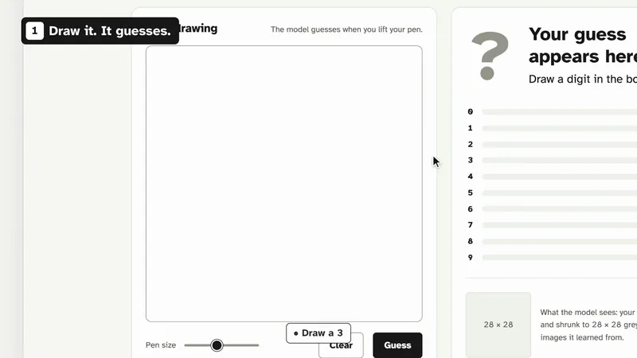

# Handwriting Lab — MNIST
<p align="center">
  <a href="https://handwriting.kooexperience.com"></a>
  <br>
  <a href="https://handwriting.kooexperience.com/?tour=1">▶ 30-second tour</a> · <a href="https://handwriting.kooexperience.com/">Live app</a> · <a href="https://kooexperience.com/">kooexperience.com</a>
  <br>
  <sub>Music: Sascha Ende, ende.app (CC BY 4.0)</sub>
</p>

End-to-end MNIST digit classification: training, inference API, and a custom FastAPI-served web app. Started as a course project.

---

## Project layout

```
.
├── src/
│   ├── mnist/                  # Shared library (model, data, utils)
│   ├── mnist_fastapi/          # FastAPI inference service + custom web UI
│   ├── mnist_streamlit/        # Legacy Streamlit app (not used for Railway deploy)
│   └── train_model.py          # Training entry point (Hydra + MLflow)
├── streamlit_app.py            # Legacy Streamlit app
├── conf/                       # Hydra / logging configs
├── docs/training_pipeline.md   # In-app guide for training/deployment flow
├── artifacts/                  # Optional baked model for single-service deploy
├── scripts/retrain_local_model.sh
│                              # Local retrain + model staging script
├── railway.toml                # Railway build/deploy config (FastAPI container)
├── streamlit.Containerfile     # Legacy Streamlit container
├── inference.Containerfile     # Docker image for FastAPI + web frontend
├── train_model.Containerfile   # Docker image for training
├── setup-streamlit.sh          # Parameterized app deployment script
├── requirements-streamlit.txt  # Pip deps for the drawing app container
└── pyproject.toml              # uv project deps (training, backend, dev)
```

---

## Local development (uv)

```bash
# Install all dependency groups
uv sync --group dev --group training --group backend

# Run tests
uv run pytest src/tests/

# Lint
uv run ruff check src/

# Run FastAPI web app locally
uv run --group backend uvicorn mnist_fastapi.main:APP --app-dir src --reload
```

---

## Containers — what runs where

| Container | Containerfile | What it does | Default port |
|---|---|---|---|
| `mnist-web` | `inference.Containerfile` | FastAPI API + custom handwriting web UI | 8080 |
| `mnist-streamlit` | `streamlit.Containerfile` | Legacy Streamlit UI | 8080 |
| training job | `train_model.Containerfile` | Hydra + MLflow training | — (batch job) |

---

## Deploying the app under your custom domain

`setup-streamlit.sh` is now parameterized so the same script works for local,
cpubox/devbox bridge mode, and a website path prefix.

### Example: host app at `https://handwriting.kooexperience.com/`

```bash
APP_BASE_PATH= \
PUBLIC_URL=https://handwriting.kooexperience.com \
MNIST_API_BASE_URL=http://10.0.0.3:8081 \
./setup-streamlit.sh
```

### Example: enable bridge mode (devbox -> cpubox)

```bash
ENABLE_SOCAT_BRIDGE=true \
SOCAT_TARGET_HOST=10.0.0.3 \
HOST_PORT=8123 \
./setup-streamlit.sh
```

### Useful deployment env vars

| Variable | Default | Purpose |
|---|---|---|
| `APP_BASE_PATH` | empty | Optional URL path prefix for Streamlit (leave empty for custom domain root) |
| `PUBLIC_URL` | empty | Printed public URL helper |
| `MNIST_API_BASE_URL` | `http://10.0.0.3:8081` | FastAPI backend URL |
| `ENABLE_SOCAT_BRIDGE` | `false` | Start local socat bridge |
| `SOCAT_TARGET_HOST` | `10.0.0.3` | Bridge target host |
| `HOST_PORT` | `8123` | Host listening port |
| `ENABLE_BOOT_AUTOSTART` | `false` | Add startup commands to `~/.bashrc` |

### Backend URL switching

The drawing app (`streamlit_app.py`) checks the `MNIST_API_BASE_URL` env var:

| Env var set? | Backend | Auth |
|---|---|---|
| Yes | Whatever URL you pass | None (direct HTTP) |
| No | Cloud Run URL | GCP ID token |

For local / cpubox development always set the env var. The Cloud Run path is only used when the app is deployed on GCP itself.

---

## Railway (simple + cheap)

Recommended setup is **one service** using `inference.Containerfile`.
The same FastAPI service hosts:
- the web UI at `/`
- inference endpoints at `/api/v1/model/*`

1. Train locally and export model:

```bash
SKIP_PROCESS_DATA=true NO_CUDA=true NO_MPS=false ./scripts/retrain_local_model.sh
```

2. The retrain script auto-stages Railway artifact to `artifacts/model.pth`.
   If you disabled that behavior, stage manually:

```bash
mkdir -p artifacts
cp data/local-model-export/model.pth artifacts/model.pth
```

3. Deploy this repo to Railway (it uses `railway.toml` + `inference.Containerfile`).

4. Set Railway env vars:

```bash
PRED_MODEL_PATH=artifacts/model.pth
USE_CUDA=false
USE_MPS=false
CORS_ALLOW_ORIGINS=https://handwriting.kooexperience.com,https://kooexperience.com,http://localhost:8000,http://127.0.0.1:8000,http://localhost:8080,http://127.0.0.1:8080
RATE_LIMIT_ENABLED=true
RATE_LIMIT_REQUESTS=60
RATE_LIMIT_WINDOW_SECONDS=60
```

Notes:
- `PRED_MODEL_PATH` defaults to `artifacts/model.pth`.
- The FastAPI container binds to `PORT` automatically for Railway.
- `CORS_ALLOW_ORIGINS` should list the browser origins allowed to call your API.
- The built-in FastAPI frontend at `/` is same-origin, so CORS is mainly for any separate website calling the API from browser JavaScript.
- The app-level rate limiter is per-process and per-IP. Keep edge/WAF rate limiting enabled as well if your host supports it.

---

## Local retraining for rotated/inverted handwriting

Use the helper script to retrain locally with augmentation and stage `model.pth`.

```bash
ROTATION_DEGREES=60 \
ROTATION_PROB=0.8 \
INVERT_PROB=0.1 \
TRAIN_EPOCHS=6 \
./scripts/retrain_local_model.sh
```

This now also generates an evaluation report by default:
- `reports/evaluation_latest.json` (accuracy, per-class metrics, confusion matrix)

Key options:
- `ROTATION_DEGREES`: max random rotation angle
- `ROTATION_PROB`: chance to apply rotation per sample
- `INVERT_PROB`: chance to invert pixel values per sample
- `UPLOAD_TO_GCS=true`: optionally upload staged model after local training; requires `GCS_TARGET_PATH` (e.g. `gs://your-bucket/inference/model.pth`)

Training-time augmentation config also exists in `conf/train_model.yaml`:
- `enable_train_augmentation`
- `train_rotation_degrees`
- `train_rotation_prob`
- `train_invert_prob`

---

## In-app pages

The FastAPI web app (`/`) includes:
- `Playground` tab (canvas inference)
- `Evaluation` tab (confusion matrix + per-class metrics from local report JSON)
- `Pipeline Guide` tab (loaded from `docs/training_pipeline.md`)

---

## Deploy

Railway builds `inference.Containerfile` and deploys every push to `main`. The served model is the committed `artifacts/model.pth`.

---

## Key env vars

| Variable | Where it's used | Example |
|---|---|---|
| `PRED_MODEL_PATH` | FastAPI container | `artifacts/model.pth` |
| `PRED_MODEL_UUID` | FastAPI container | `mnist-local-001` |
| `USE_CUDA` | FastAPI container | `false` |
| `USE_MPS` | FastAPI container | `false` |
| `CORS_ALLOW_ORIGINS` | FastAPI container | `https://handwriting.kooexperience.com,https://kooexperience.com,...` |
| `RATE_LIMIT_ENABLED` | FastAPI container | `true` |
| `RATE_LIMIT_REQUESTS` | FastAPI container | `60` |
| `RATE_LIMIT_WINDOW_SECONDS` | FastAPI container | `60` |
| `MLFLOW_TRACKING_URI` | Training | your MLflow server |
| `train_rotation_degrees` | `conf/train_model.yaml` | `60` |
| `train_rotation_prob` | `conf/train_model.yaml` | `0.8` |
| `train_invert_prob` | `conf/train_model.yaml` | `0.1` |
